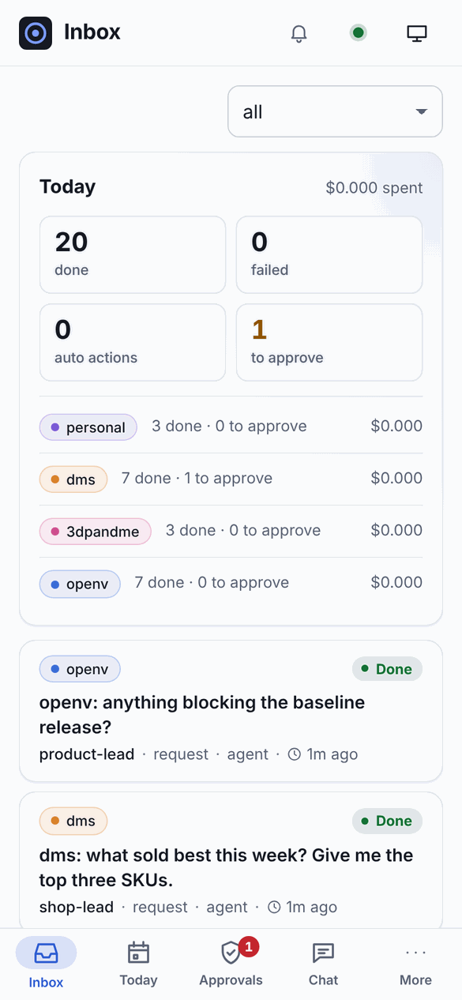
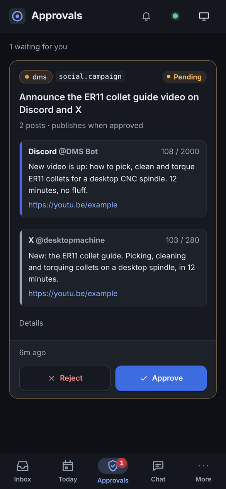
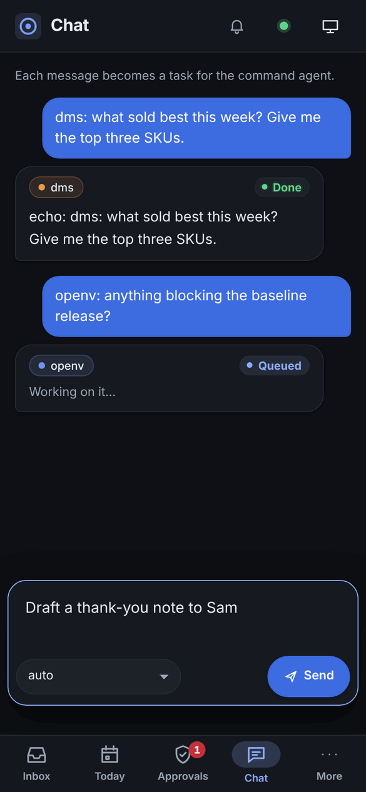
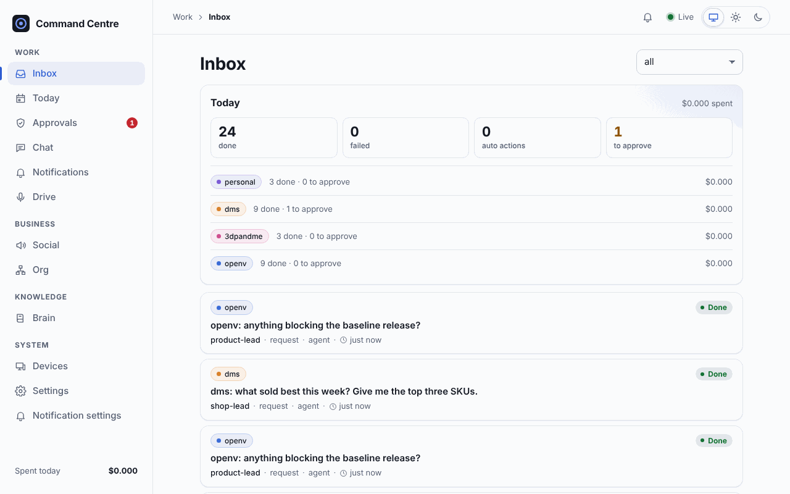
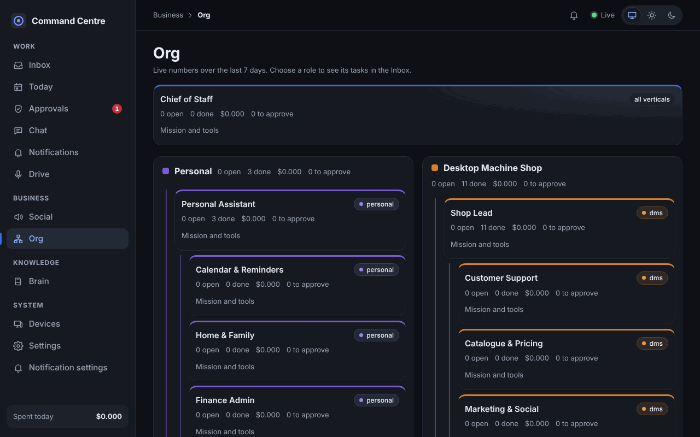

# Command Centre

Central hub for day-to-day management of Dave's businesses, side projects and life admin:
Desktop Machine Shop, 3dpandme, OpenV, OpenD and personal.

- An always-on **server** takes in events (chat, schedules, webhooks; email and Odoo in Phase 1).
- A **triage** step sorts each event cheaply (rules now, Jev in Phase 1).
- Real work goes to an **agent**, driven by Claude Code on the Claude subscription.
- Agents read and write a markdown **brain** and use a shared **skills bank**.
- Anything outward-facing becomes a **proposal**, which runs straight away or waits for approval
  depending on policy.
- A **PWA** (phone and desktop) shows the inbox, approvals, chat (type, dictate, or attach, paste and drop files for the agent), brain (edit notes there), businesses (edit policies and specialists there) and worker devices.

```
apps/server            API, WebSocket hub, pipeline, scheduler, MCP endpoints (/mcp/brain, /mcp/actions)
apps/web               PWA
apps/worker            worker daemon for PCs: runs ffmpeg, GPU and local Claude Code jobs
apps/desktop           Tauri app for Windows: the PWA in a window, the worker as a sidecar, tray icon
packages/core          shared types and WebSocket protocol
packages/agent-runtime AgentRunner harness + Claude Code adapter (+ API-key fallback)
packages/brain         markdown brain in Postgres (history, search) + MCP server
packages/email         IMAP inbox poller, read-only mail MCP server (/mcp/mail, attachments as text), email.* executors
packages/odoo          Odoo client (JSON-RPC / JSON-2), read-only MCP server (/mcp/odoo), Odoo actions
packages/sendcloud     Sendcloud client (read-only): parcel tracking for the daily digest and Odoo delivery-order notes, MCP server (/mcp/sendcloud)
packages/pa            personal assistant: reminders, to-do lists, Google Calendar, MCP server (/mcp/pa)
packages/social        social platform adapters, inbound watcher, social.* executors, scheduled posts
packages/storage       BlobStore: large files on the volume or Google Drive, LRU cache, resumable uploads
packages/triage        triagers (rules, Jev, Haiku fallback) + accuracy eval
packages/video         VideoSpec, TTS adapters, Playwright capture, captions, ffmpeg compositor
packages/verticals     one manifest per business / life area
packages/voice         speech-to-text / text-to-speech clients (OpenAI, ElevenLabs, fake) + speakable text
skills/                shared skills bank (Agent Skills format)
```

## The app

The PWA is phone-first with a bottom tab bar and a "More" sheet. On a PC it has a grouped sidebar.
It comes in light and dark (System / Light / Dark in the header). The design tokens, components and
the data-driven nav are documented at the top of `apps/web/src/styles.css`, `apps/web/src/ui.tsx`
and `NAV` in `apps/web/src/App.tsx`. More screenshots are in [docs/screenshots](docs/screenshots).

<p>
  
  
  
</p>




## Docs

- [docs/ARCHITECTURE.md](docs/ARCHITECTURE.md): architecture and phased plan
- [docs/SETUP.md](docs/SETUP.md): running locally and deploying to Railway
- [docs/ORG.md](docs/ORG.md): the assistant and the specialists, routing, each business's how-we-work note, handoffs and editing them from the app
- [docs/VIDEO.md](docs/VIDEO.md): the video pipeline for OpenV and OpenD content
- The user guide: [command-centre.opend.app](https://command-centre.opend.app), from the OpenD project in [docs/](docs/opend.config.yaml).
  In the app, **?** in the top bar (or F1) opens it on the page in use. See [docs/SETUP.md](docs/SETUP.md), "In-app help".
