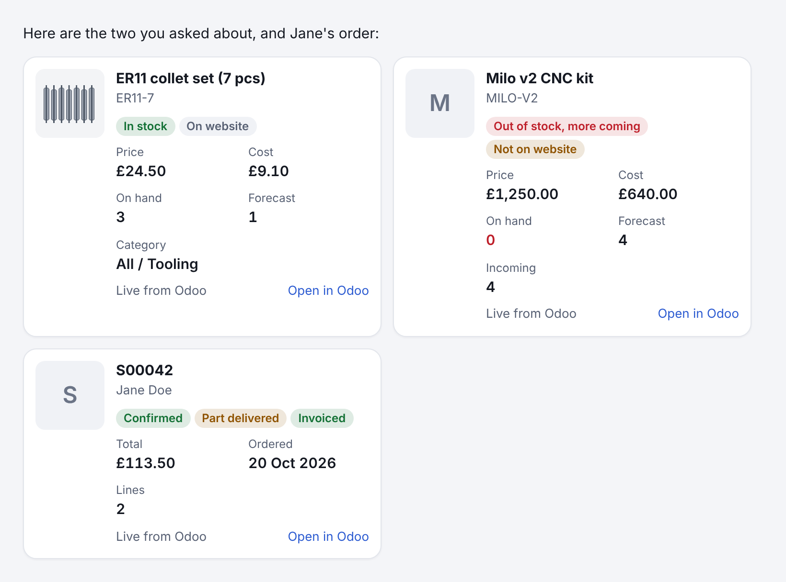

# Cards: how an integration shows a record

A card is a small, tidy view of one record from an integration: a product with its picture,
part number, price and stock; an order with its customer, total and status. Every integration
uses the same card, so they all look and behave alike in chat.



## How it works

1. **The agent writes a reference, not data.** In its reply it puts a fenced block with the
   language `card` and one reference per line:

   ````
   ```card
   odoo.product:42
   odoo.order:S00042
   ```
   ````

   A reference is `<integration>.<type>:<id>`. The id is whatever the integration looks the
   record up by (for `odoo.product`, the product id or its exact SKU).
2. **The app asks the server.** The chat's markdown renderer turns the block into
   `GET /api/cards?refs=…` (`apps/web/src/cards.tsx`).
3. **The server asks the integration** (`apps/server/src/cards.ts`, `CardService`), which reads
   the record live and answers a `Card` (`packages/core/src/cards.ts`).

So a card always shows **live, trusted data**: stock as it is now, not as the model remembers
it, and nothing the model made up. A reply restored from history shows today's figures. A
reference that can't be resolved shows as a small dashed box with the reason. Cards are
read-only and need no approval; changing a record is still a proposal.

Agents are told which kinds they can use in a "## Cards" section of their system prompt, limited
to the integrations (MCP servers) that run has. Cards are not read aloud.

## The card

| Field | What it is |
| --- | --- |
| `title` | The record's name. |
| `subtitle` | One muted line: a part number, the customer, a date. |
| `image` | A small picture: an `https:` URL or a `data:image/(png|jpeg|gif|webp)` URL. Anything else is not drawn. |
| `url` | Opens the record where it lives ("Open in Odoo"). `http(s)` only. |
| `badges` | Up to 4 short states with a tone (`good`, `warn`, `bad`, `neutral`): "In stock", "Not on website". |
| `facts` | Up to 8 label and value pairs, already formatted for reading ("£24.50"), each with an optional tone. |
| `footnote` | One small line, e.g. "Live from Odoo". |

Keep a card to what someone needs at a glance. More detail belongs in the agent's words or
behind the link.

## Kinds today

| Kind | Id | Shows |
| --- | --- | --- |
| `odoo.product` | product id or SKU | picture, part number, price, cost, on hand, forecast, incoming, category, barcode; in stock / out of stock / archived / on website |
| `odoo.order` | order id or number | customer, total, dates, lines; state, delivery and invoice status |
| `odoo.customer` | contact id or email | picture, company, email, phone, town, orders |

## Adding cards to an integration (the standard)

Every integration that has records worth showing provides cards the same way:

1. In the integration's package, export a function returning `Record<string, CardProvider>`
   keyed by kind (`<integration>.<type>`; the first part must be the integration's MCP server
   name, which is how agents without that integration are kept from being offered its cards).
   A provider has a one-line `description` for the agents (what it shows, what the id may be)
   and `resolve(id)`, which answers the card's fields or `null` when there is no such record.
   See `packages/odoo/src/cards.ts`.
2. Read only. Format values for reading (money with its currency, dates as "20 Oct 2026").
   Leave out what the record doesn't have rather than showing blanks. Never put secrets or
   another customer's data on a card.
3. Add the providers where the server builds the integration (`apps/server/src/app.ts`, the
   `CardService` line), so connecting or changing it on the Accounts page applies at once.
4. Test the provider against the integration's fake (see `packages/odoo/test/cards.test.ts`).

The app needs no change for a new kind: `RecordCard` draws any card. A kind may get its own
styling through its `kind-<integration>-<type>` class, but shouldn't need it.

Good next kinds: `sendcloud.parcel` (tracking status), `odoo.invoice`, `odoo.delivery`,
`social.post`, `mail.message`, `pa.event`.
