# Org chart

Every agent run works as a **role**: the Chief of Staff at the top, one lead per vertical, and
specialists under each lead. A role decides:

- **which tasks it gets**: the triage intents it owns, schedules it owns, or Dave naming it;
- **what it sees**: only its own skills are linked into its workspace, and it can reach only its
  own MCP servers;
- **how it behaves**: its title, mission, reporting line and autonomy notes go into the system
  prompt, with a short list of the other roles so it can hand work on.

Roles never change policy. Whether an action runs straight away or waits for Dave is still decided
by the vertical's `policies` (and untrusted input always makes it a draft). The `actions` and
`autonomyNotes` of a role tell the agent what it is expected to propose, and they are shown in the
app.

The org starts in code and can be changed from the app:

- the roles of each vertical are in `packages/verticals/src/<vertical>.ts`, under `roles`
  (OpenV and OpenD share `saas-org.ts`);
- the Chief of Staff, the org root, is in `packages/verticals/src/org.ts`;
- the schema and its checks are in `packages/core/src/vertical.ts` (`Role`, `orgIssues`);
- changes made on the Org page are stored in Postgres and run over the code (see
  [Editing from the app](#editing-from-the-app)).

The **Org** page in the app shows the chart with live numbers per role (open tasks, tasks done in
the last 7 days, cost over 7 days and approvals waiting). Choose a role to see its tasks in the
Inbox. The same tree is served at `GET /api/org`.

## The draft org

```mermaid
flowchart TD
  cos["Chief of Staff"]

  cos --> pa["Personal Assistant"]
  pa --> cal["Calendar & Reminders"]
  pa --> home["Home & Family"]
  pa --> fin["Finance Admin"]

  cos --> shop["DMS: Shop Lead"]
  shop --> cs["Customer Support"]
  shop --> cat["Catalogue & Pricing"]
  shop --> mkt["Marketing & Social"]
  shop --> ops["Ops & Admin"]

  cos --> content["3dpandme: Content Lead"]
  content --> video["Video Producer"]
  content --> blog["Blog Writer"]
  content --> community["Community Manager"]

  cos --> vlead["OpenV: Product Lead"]
  vlead --> vsup["Support Engineer"]
  vlead --> vdev["DevRel & Content"]
  vlead --> vbill["Billing & Admin"]

  cos --> dlead["OpenD: Product Lead"]
  dlead --> dsup["Support Engineer"]
  dlead --> ddocs["Docs Writer"]
  dlead --> ddev["DevRel & Content"]
  dlead --> dbill["Billing & Admin"]
```



## Roles

Tools are the MCP servers a role can reach (every run also gets `actions`) and the action types
it normally proposes. Missions are shortened to their first sentence; the full text is in the
manifests and on the Org page. All schedules ship turned off.

| Vertical | Role (id) | Reports to | Mission | Intents | Skills | Tools | Schedules |
| --- | --- | --- | --- | --- | --- | --- | --- |
| all | **Chief of Staff** (`chief-of-staff`) | Dave | Keeps Dave's whole portfolio pointed at what matters today. | – | brain-notes | brain; notify, brain.journal, brain.write; sees approvals in every vertical | morning-brief (07:00 weekdays) |
| personal | **Personal Assistant** (`pa`) | chief-of-staff | Dave's first stop for anything personal. | question | brain-notes, email-triage-and-reply | brain; brain.journal, brain.write, notify, email.reply | – |
| personal | **Calendar & Reminders** (`calendar-reminders`) | pa | Makes sure nothing with a date slips. | reminder | brain-notes | brain; notify, brain.journal, brain.write | – |
| personal | **Home & Family** (`home-family`) | pa | Plans the family side of life: trips, outings, events, gifts and household purchases. | plan | brain-notes, email-triage-and-reply | brain; brain.write, notify, email.send | – |
| personal | **Finance Admin** (`finance-admin`) | pa | Keeps personal paperwork in order. | admin | brain-notes, email-triage-and-reply | brain; brain.write, notify, email.reply | – |
| dms | **Shop Lead** (`shop-lead`) | chief-of-staff | Runs Desktop Machine Shop day to day on Dave's behalf. | (unowned: spam, other) | brain-notes, email-triage-and-reply, dms-customer-reply, dms-order-status | brain, odoo; brain.write, notify, email.reply | – |
| dms | **Customer Support** (`customer-support`) | shop-lead | Answers customers the way Dave would. | presales-question, order-status, return-warranty | brain-notes, email-triage-and-reply, dms-customer-reply, dms-order-status, social-platform-guide, social-voice-dms | brain, odoo; email.reply, odoo.message.post, social.reply, social.dm, brain.write | – |
| dms | **Catalogue & Pricing** (`catalogue-pricing`) | shop-lead | Keeps the Odoo catalogue accurate and the prices competitive. | – | brain-notes, dms-catalogue-pricing | brain, odoo; odoo.product.update_price, brain.write | – |
| dms | **Marketing & Social** (`marketing-social`) | shop-lead | Gets the shop in front of hobbyist machinists. | – | brain-notes, social-voice-dms, social-platform-guide | brain, odoo; social.post, social.campaign, odoo.blog.draft | – |
| dms | **Ops & Admin** (`ops-admin`) | shop-lead | Handles the back office: suppliers, stock, invoices and bills. | supplier, invoice-admin | brain-notes, email-triage-and-reply | brain, odoo; email.reply, odoo.message.post, notify, brain.write | low-stock-check (08:15 weekdays) |
| 3dpandme | **Content Lead** (`content-lead`) | chief-of-staff | Owns the 3dpandme content plan. | content-idea, collab | brain-notes, social-voice-3dpandme, social-platform-guide, email-triage-and-reply | brain, odoo; brain.write, notify, email.reply | – |
| 3dpandme | **Video Producer** (`video-producer`) | content-lead | Takes a video from plan to published. | publishing | brain-notes, social-voice-3dpandme, social-platform-guide | brain; social.campaign, brain.write | – |
| 3dpandme | **Blog Writer** (`blog-writer`) | content-lead | Writes 3dpandme blog posts in Dave's maker voice. | – | brain-notes, social-voice-3dpandme | brain, odoo; odoo.blog.draft, brain.write | – |
| 3dpandme | **Community Manager** (`community-manager`) | content-lead | Looks after the 3dpandme community. | comment-reply | brain-notes, social-voice-3dpandme, social-platform-guide | brain; social.reply, social.dm, notify, brain.write | – |
| openv, opend | **Product Lead** (`product-lead`) | chief-of-staff | Owns the product's direction on Dave's behalf. | feature-request | brain-notes, email-triage-and-reply | brain; brain.write, notify, email.reply | – |
| openv, opend | **Support Engineer** (`support-engineer`) | product-lead | Helps users get unstuck. | support, bug | brain-notes, email-triage-and-reply | brain; email.reply, brain.write, notify | – |
| opend | **Docs Writer** (`docs-writer`) | product-lead | Keeps the OpenD documentation clear and current. | – | brain-notes | brain; brain.write | – |
| openv, opend | **DevRel & Content** (`devrel-content`) | product-lead | Tells people what the product does and why it matters. | – | brain-notes, social-platform-guide | brain; social.post, social.campaign, brain.write | – |
| openv, opend | **Billing & Admin** (`billing-admin`) | product-lead | Handles subscriptions, invoices and payment questions. | billing | brain-notes, email-triage-and-reply | brain; email.reply, brain.write, notify | – |

`dms-catalogue-pricing` is the only skill added for the org. The other roles reuse the existing
skills bank; their charter travels in the system prompt.

## How a task gets its role

When a task is created, after triage (`routeRole` in `packages/verticals/src/routing.ts`):

1. **Assigned.** A schedule owned by a role, a handoff, or the chat API's `role` field names it
   (`payload.role`). Only chat, cron and the server's own events may set this; an email can't
   choose its role.
2. **Named in chat.** A chat that starts with a role name and a colon goes to that role:
   `support: where is S00042?`, `dms/pricing: check ER11 collets`, `opend support: login loop`,
   `cos: what matters today?`. The id, an alias or the title all work
   (`Customer Support: ...`). A name only one vertical has moves the chat there (`pricing: ...`
   goes to DMS). A name several verticals share (`support`) goes to the triaged vertical's role,
   or else to its lead.
3. **Intent owner.** The role that lists the triage intent.
4. **The lead.** Anything else, including `spam`, `other`, chat `request`s and `scheduled`.

The role is stored on the task (`tasks.role`, migration `0005_roles`) and shown in the Inbox.
Tasks from before roles have no role and count as the vertical lead's.
`GET /api/tasks?vertical=dms&role=customer-support` lists one role's tasks.

## What a run gets

- **Workspace:** `workspaces/<vertical>/<role>`, with only the role's skills linked into
  `.claude/skills`. Runs of one role can overlap, so the links are updated in place, never wiped.
  The old vertical-level `workspaces/<vertical>/.claude` is removed, so its skills can't leak into
  role folders.
- **MCP servers:** the role's `mcpServers`, or the vertical's when the role doesn't list any. The
  run token carries the role, and `/mcp/<server>` refuses servers the role doesn't have.
- **System prompt:** the role charter (title, mission, who it reports to, intents, usual actions,
  autonomy notes) and the other roles it can hand work to, each with one line and its intents.
- **Concurrency and budgets** stay per vertical. The Chief of Staff runs in its home vertical,
  `personal`.

## Handoffs

Every run has the `actions` tool `handoff_to_role(roleId, note)`. It creates a new task for
another role with the note and the original request, and the agent then stops.

- `roleId` is a role in the same vertical (id, alias or title), or `chief-of-staff` to escalate.
- Only the Chief of Staff hands work across verticals, as `<vertical>/<role>`
  (`dms/customer-support`).
- **Loop protection:**
  - at most 3 handoffs in one chain (`MAX_HANDOFF_DEPTH`, `maxHandoffDepth` on the pipeline);
  - never back to a role already in the chain, and never to yourself;
  - one handoff per task and target, so a repeat returns the existing task.

  The system prompt tells the agent how many handoffs are left. At the limit, the tool refuses
  and the agent finishes the work or notifies Dave.
- **Trust carries over:** a handoff task keeps the source of the event that started its chain.
  Work that began with an email or webhook still gets only draft proposals after any number of
  handoffs, and its prompt says the request came from outside.
- Handoffs are internal, so they need no approval and cost nothing until the new task runs.

## Editing from the app

On the **Org** page, press **Edit**:

- the pencil on a role card edits that role: title, who it reports to, mission, autonomy notes,
  the intents it owns, skills, MCP servers, the actions it usually proposes, chat aliases, KPIs and
  schedules. **Add role** adds one under a vertical, and **Remove** takes one out (move the roles
  reporting to it first; the lead can't be removed).
- Picking an intent another role owns moves it. Making a role report to the Chief of Staff makes it
  the lead, and the old lead then reports to it.
- **Policies** sets, per action type, whether it waits for approval, runs and is listed in the
  digest, or runs straight away. Untrusted input still always makes a draft.
- **History** lists every save, with **Restore**, and **Reset to code** goes back to the manifest.

What runs:

- Each vertical (its whole `roles` list, `policies` and `defaultPolicy`) and the Chief of Staff
  (everything but its id and home vertical) is saved as one document in `org_overrides`, with every
  save and reset in `org_override_versions` (migration `0015_org_overrides`).
- A save is checked as a whole org first, with the same checks as the manifests plus "every skill is
  in the bank", and refused with the list of problems. A save over a stale version gets a 409.
- An accepted save applies at once: the next task, handoff and chat prefix use it, and schedules
  are restarted. Running tasks keep the prompt they started with.
- A vertical's intents, skills, servers and budget stay in code. So does a new intent: add it to
  the manifest first.
- If a code change makes a saved change invalid (say an intent the saved roles own is removed), the
  server logs it at boot and runs the code's version of that vertical. The Org page shows the
  problem until the change is saved again or reset.
- A change in the app shadows later code changes to that vertical's roles until it is reset.

The API is `GET /api/org/config`, `PUT /api/org/config/:unit` (`{ data, expectedVersion }`),
`DELETE /api/org/config/:unit?expectedVersion=` (reset), `GET /api/org/config/:unit/history`,
`GET /api/org/config/:unit/versions/:version` and `POST /api/org/config/:unit/restore`. `:unit` is
a vertical id or `chief-of-staff`. Code: `apps/server/src/org-config.ts`,
`apps/web/src/pages/OrgEdit.tsx`.

## Adding or changing a role in code

1. Edit the vertical's manifest in `packages/verticals/src/`. Add an entry to `roles`:

   ```ts
   {
     id: "wholesale",                 // unique in the vertical, lower-case-with-dashes
     title: "Wholesale",
     reportsTo: "shop-lead",          // a role id, or "chief-of-staff" for the lead
     aliases: ["trade"],              // optional extra chat names
     mission: "Two or three sentences on what it does and what good looks like.",
     intents: ["wholesale-enquiry"],  // must be in the vertical's intents; one owner each
     skills: ["brain-notes", "email-triage-and-reply"],
     mcpServers: ["brain", "odoo"],   // optional subset of the vertical's
     actions: ["email.reply"],        // what it usually proposes (display and prompt only)
     schedules: [],                   // optional; ids unique across the vertical
     kpis: ["Quotes out within a day"],
     autonomyNotes: "Drafts every quote; discounts always need Dave.",
   }
   ```

2. A new intent also goes in the vertical's `intents`, and a line in `INTENT_HINTS`
   (`packages/triage/src/shared.ts`) helps model triagers pick it.
3. A new skill goes in `skills/<name>/SKILL.md` (the tests check every role's skills exist).
4. Run `pnpm test`. The manifest is checked when it loads:
   - role ids and aliases are unique;
   - there is exactly one lead;
   - every `reportsTo` exists, with no cycles;
   - role intents are declared by the vertical, with at most one owner each;
   - role MCP servers belong to the vertical;
   - schedule ids are unique.

A vertical with no `roles` still works: it gets one implicit lead (`lead`) with the vertical's
skills and servers, as before roles existed.

Removing or renaming a role is safe. Its old tasks keep the id and count as the lead's on the
Org page.
